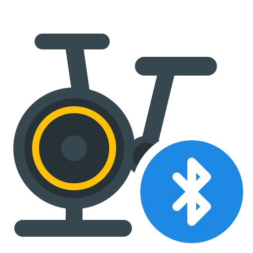

# FTMS indoor bike (on demand) for Home Assistant

[](https://github.com/andrewgould/ha-ftms-bike/actions/workflows/validate.yml)
[](https://github.com/andrewgould/ha-ftms-bike/releases)

Reads an indoor bike's live data and sets its resistance or target power over
the Bluetooth **Fitness Machine Service** (FTMS), the same protocol Kinomap,
Zwift and other training apps use. It goes through Home Assistant's own
Bluetooth, so an ESPHome Bluetooth proxy within reach of the bike is all it
needs.

## What it does

Bike consoles take **one Bluetooth connection at a time**. An integration that
stays connected would lock training apps out for good, so this one connects
only during a **session** that someone starts:

- Turning on the **Session** switch connects to the bike.
- The session ends when the switch is turned off, when the bike drops the
  connection, or after **5 minutes without pedalling**.
- Nothing reconnects by itself, and a session never survives a restart.
- Setting up the integration doesn't connect to the bike either.

Outside a session the bike is free for any app, and the readings show as
unavailable.

| Entity | Notes |
| --- | --- |
| Session | Switch. Available while the bike is advertising (its console is awake) |
| Speed, Cadence, Power, Resistance, Distance, Calories, Elapsed time | As the console reports them, about once a second. Distance and time count from when the console started |
| Heart rate | Only when a heart-rate strap is paired to the console |
| Target resistance | In the console's own levels. Setting it takes control of the bike and cancels any target power |
| Target power | Watts. The console adjusts the resistance itself to hold it ("ERG mode") |

The targets work only during a session. Scripts and automations should turn on
the session first.

## Resistance scale

The standard says the resistance command is one byte in tenths of a level,
which can't reach past level 25.5. Consoles with more levels than that disagree
about what to do instead, and nothing the bike reports says which one it is.
The options offer:

- **Tenths of a level** (the standard): raw 80 is level 8.
- **0-255 spread over all the levels**: on a 32-level console raw 100 is level
  12 and 255 is level 32. Anything over 255 wraps.
- **Automatic** (the default): spread for consoles reporting more than 25
  levels, tenths otherwise.

If setting a level lands on a different level on the console, switch to the
other one.

## Install

Through [HACS](https://hacs.xyz), as a custom repository:

[](https://my.home-assistant.io/redirect/hacs_repository/?owner=andrewgould&repository=ha-ftms-bike&category=integration)

Or in HACS, **⋮ → Custom repositories**, add
`https://github.com/andrewgould/ha-ftms-bike` as an **Integration**, then
download **FTMS indoor bike (on demand)** and restart Home Assistant.

Without HACS, unzip `ftms_bike.zip` from the
[latest release](https://github.com/andrewgould/ha-ftms-bike/releases/latest)
into `custom_components/ftms_bike` and restart.

## Setup

Pedal for a moment to wake the console. Home Assistant should then offer the
bike under **Settings → Devices & services → Discovered**. Otherwise add
**FTMS indoor bike (on demand)** and pick it from the list.

The bike needs to be within reach of a Bluetooth adapter or an
[ESPHome Bluetooth proxy](https://esphome.io/components/bluetooth_proxy.html)
with active connections enabled. A session uses one of the proxy's three
connection slots while it lasts.

## Tested with

- Lifespan Fitness SM-810 Commercial spin bike. Its console has **two** FTMS
  modules, advertising as `FS-92D16A` and `62F-000002-B2`. Both work, but they
  read resistance differently: `FS-92D16A` spreads 0-255 over its 32 levels,
  the other reads tenths. Either can be set up; one is enough.
- An ESPHome Bluetooth proxy on an ESP32-S3, about -65 dBm through a wall
- Home Assistant 2026.10

## Releasing

Bump `version` in `manifest.json`, add a matching `## X.Y.Z` section to
`CHANGELOG.md`, then tag and push:

```
git tag vX.Y.Z && git push origin vX.Y.Z
```

The Release workflow checks the tag against the manifest, runs the tests,
builds `ftms_bike.zip` and publishes the release with that changelog section
as its notes. HACS installs from the zip.

The icon is drawn by `assets/make_icons.py`, which writes the PNGs into the
integration's `brand/` folder.
